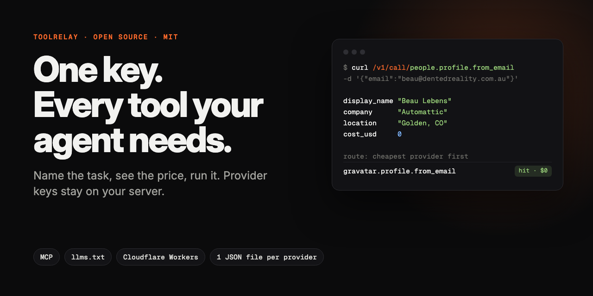
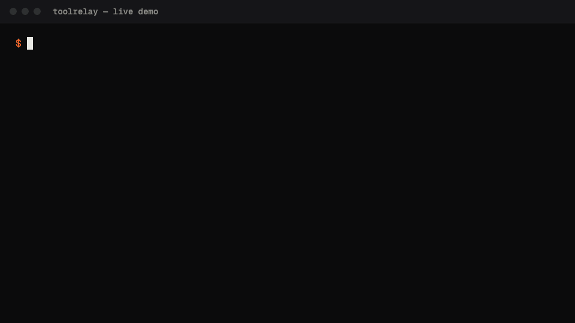

# toolrelay

### 키 하나로, 에이전트가 필요한 모든 도구를.

**AI 에이전트용 오픈소스 도구 게이트웨이.** 할 일을 말하면, 값을 보여 주고, 실행합니다.
업체 키는 서버 밖으로 나가지 않고, 결과당 과금 업체는 못 찾으면 0원입니다. Cloudflare 무료 플랜에 명령 한 줄로 올라갑니다.

[**라이브 데모 써 보기**](https://toolrelay.azet.io) (가입 없음) · [English](README.md)



위 화면은 전부 [toolrelay.azet.io](https://toolrelay.azet.io) 의 실제 응답입니다. 같은 명령을 터미널에 붙이면 같은 답이 나옵니다.

> **API 연결에 들일 오후 한나절을 아꼈다면 [별을 눌러 주세요](https://github.com/neulketing/toolrelay/stargazers).** 별은 다음 개발자가 이 저장소를 찾게 해 줍니다. 원하는 업체는 [요청 이슈](https://github.com/neulketing/toolrelay/issues?q=is%3Aissue+label%3Aprovider)에 👍 를 누르면 그 순서로 붙입니다.

## 왜 toolrelay 인가

- **업체가 아니라 일을 부른다** — `web.scrape`, `people.email.find` 처럼 부르면 키가 있는 업체를 싼 순서로 차례로 시도합니다.
- **답에만 돈을** — 결과당 과금 업체는 못 찾으면 0원이고 다음 업체로 넘어갑니다. 호출마다 과금하는 업체는 카탈로그에 표시하고 그 비용만 그대로 넘깁니다.
- **키는 서버에만** — 에이전트는 잔액이 든 toolrelay 키 하나만 가집니다. 언제든 끊을 수 있습니다.
- **서버 0대** — Worker 하나 + D1 하나. 1분 안에 배포, 전 세계 300개 도시에서 응답.
- **에이전트 기본 탑재** — MCP, `llms.txt`, 일반 HTTP. Claude Code·Codex·Cursor 에 주소 하나만 주면 됩니다.
- **JSON 파일 하나로 업체 추가** — 주소·파라미터·가격·「찾음」 판정만 적으면 경로에 자동으로 합류합니다.
- **진짜 오픈** — MIT. 나·팀·고객 누구에게 서비스해도 됩니다.

## 1분 설치

```bash
git clone https://github.com/neulketing/toolrelay && cd toolrelay
npm i && npm run setup
npx wrangler secret put ADMIN_TOKEN
npm run deploy
```

사용법·라우팅 규칙·MCP 설정·카탈로그 전체는 [English README](README.md) 를 보세요.

## 기여

업체 하나 추가 = JSON 파일 하나. [CONTRIBUTING.md](CONTRIBUTING.md) 와 [good first issue](https://github.com/neulketing/toolrelay/issues?q=is%3Aissue+is%3Aopen+label%3A%22good+first+issue%22) 를 보세요.

MIT © [AZET](https://azet.io)
