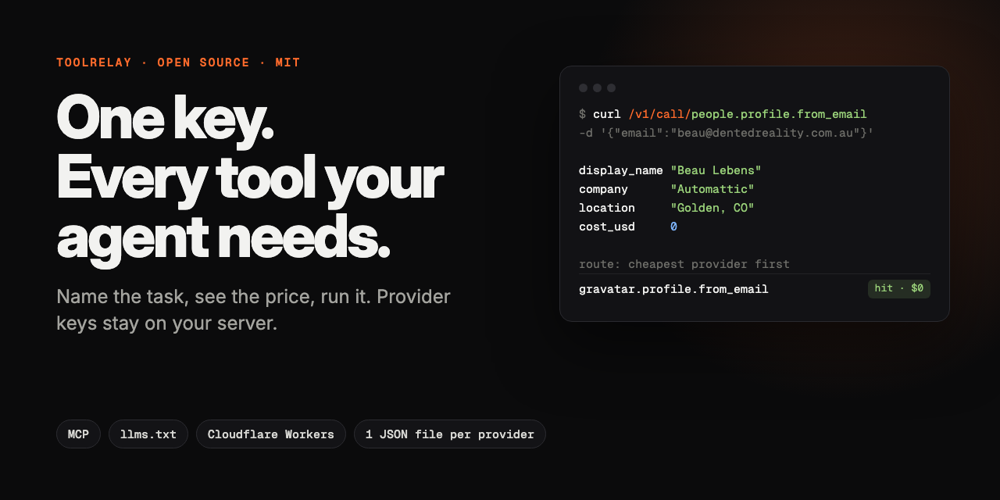
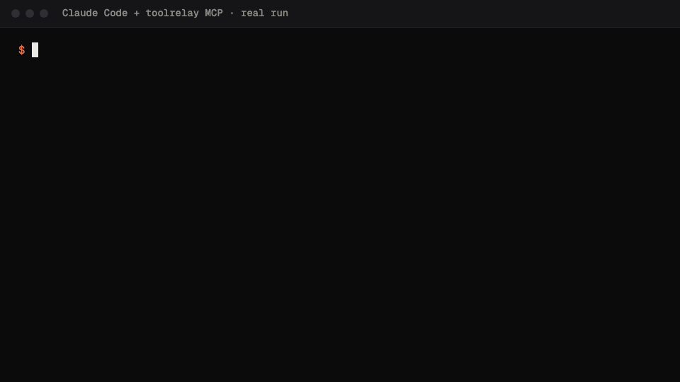
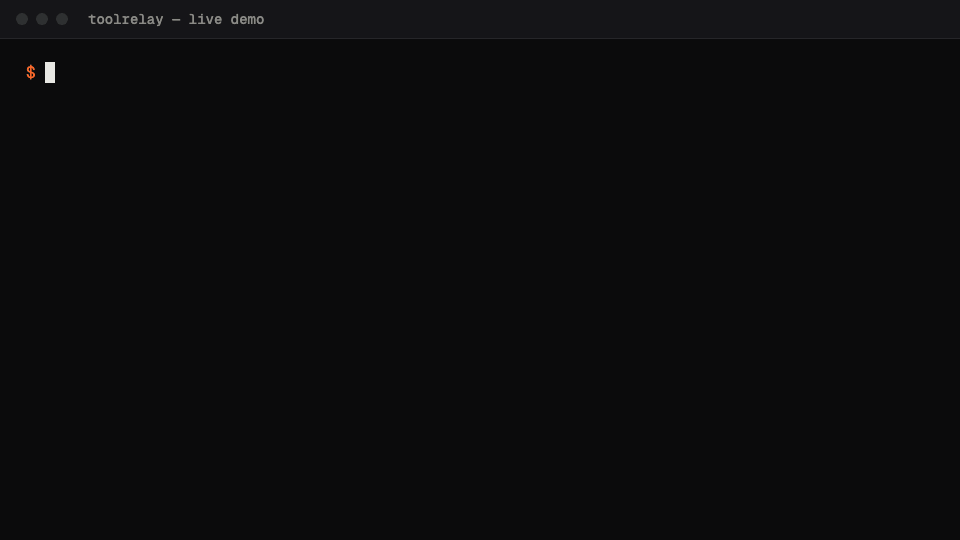
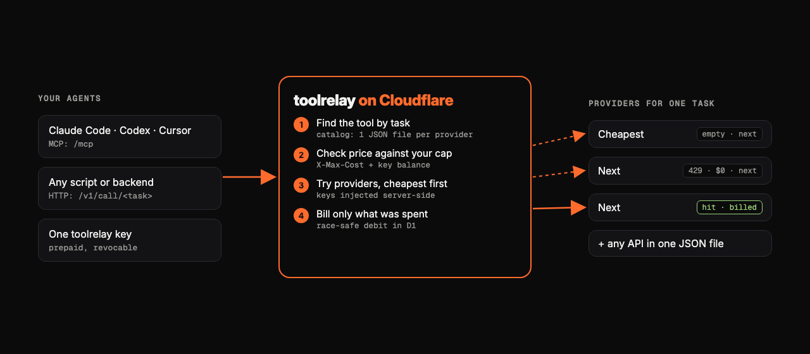

<div align="center">

<picture>
  <source media="(prefers-color-scheme: light)" srcset="assets/hero-light.png">
  
</picture>

<h3>The open-source tool gateway for AI agents.</h3>

Your agent names the task, sees what it costs, and runs it. Provider keys stay on your server.

<p>
<a href="https://toolrelay.azet.io"><b>Live demo</b></a> ·
<a href="#add-it-to-your-agent-in-one-line">Add to your agent</a> ·
<a href="#sixty-seconds-to-your-own">Self-host in 60s</a> ·
<a href="#add-a-provider-in-one-json-file">Add a provider</a> ·
<a href="https://toolrelay.azet.io/llms.txt">llms.txt</a> ·
<a href="README.ko.md">한국어</a>
</p>

[](https://github.com/neulketing/toolrelay/actions/workflows/test.yml) [](LICENSE) [](https://workers.cloudflare.com) [](#add-it-to-your-agent-in-one-line) [](https://github.com/neulketing/toolrelay/releases) [](https://glama.ai/mcp/servers/neulketing/toolrelay)

</div>

---

Your agent wants to know who is behind an email address. Today that means pasting a people-data key, a
scraper key and a search key into every agent's `.env`, then writing a system prompt that hopes the agent
picks the right vendor and stops when one comes back empty.

With toolrelay the keys live on one server and the agent gets one URL and one key.

## Add it to your agent in one line



A real Claude Code session against the live demo: it found the tool by task, called it, and reported the cost.

```bash
# Claude Code
claude mcp add --transport http toolrelay https://toolrelay.azet.io/mcp
# Codex
codex mcp add toolrelay --url https://toolrelay.azet.io/mcp
```

Cursor and other MCP clients (`~/.cursor/mcp.json`):

```json
{ "mcpServers": { "toolrelay": { "url": "https://toolrelay.azet.io/mcp" } } }
```

The demo answers free tools without a key. On your own deployment add `--header "Authorization: Bearer tr_..."`
(Claude Code) or a `headers` block, and every paid tool you hold a provider key for lights up.

## Or call it over plain HTTP



```bash
curl -s -G https://toolrelay.azet.io/v1/catalog --data-urlencode "q=profile from email"
curl -s -X POST https://toolrelay.azet.io/v1/call/people.profile.from_email -d '{"email":"beau@dentedreality.com.au"}'
```

> **If this saves you an afternoon of API wiring, [star the repo](https://github.com/neulketing/toolrelay/stargazers).**
> Stars help the next developer find it. Want a provider next? Upvote its [request](https://github.com/neulketing/toolrelay/issues?q=is%3Aissue+label%3Aprovider).

## How it works

<picture>
  <source media="(prefers-color-scheme: light)" srcset="assets/arch-light.png">
  
</picture>

## Why toolrelay

| | |
|---|---|
| **Name the task, skip the vendor hunt** | Call `web.scrape`, `people.email.find`, `serp.google`. toolrelay walks every provider you hold a key for, cheapest first. |
| **Pay for answers** | A per-result provider that finds nothing costs `$0`, and the next one is tried. |
| **Keys never leave the server** | Credentials are injected at the edge. Agents hold one revocable toolrelay key with a prepaid balance. |
| **Zero servers** | One Worker + one D1 database. Deploys in under a minute, answers from 300+ cities, fits the free plan. |
| **Agent-native** | MCP endpoint, `llms.txt`, plain HTTP. Point Claude Code, Codex or Cursor at one URL. |
| **A catalog you can read** | Every provider is one JSON file: URL, params, price, what counts as a hit. |
| **Actually open** | MIT. Run it for yourself, your team, or your customers. No hosted-service clause. |

### Three ways to give an agent tools

| | Wire each API yourself | One MCP server per vendor | toolrelay |
|---|---|---|---|
| Where provider keys live | every agent's `.env` | every agent machine's MCP config | one server; agents get one revocable key |
| When a provider is down or empty | your code handles it | the agent retries by hand | next provider, automatically |
| Price shown before the call | no | rarely | every tool, in the catalog |
| Spend cap per call / per key | build it | build it | `X-Max-Cost` + prepaid balance |
| Adding a provider | new client code | new server to install | one JSON file |

## Sixty seconds to your own

```bash
git clone https://github.com/neulketing/toolrelay && cd toolrelay
npm i
npm run setup                          # creates the D1 database + tables
npx wrangler secret put ADMIN_TOKEN    # 32+ characters
npm run deploy                         # https://toolrelay.<you>.workers.dev

# a key for your agent, with $5 of balance
curl -X POST "$TOOLRELAY/admin/keys" -H "Authorization: Bearer <admin token>" -d '{"name":"my-agent","credit_usd":5}'
```

Every provider key you add lights up more tools:

```bash
npx wrangler secret put FIRECRAWL_API_KEY
npx wrangler secret put EXA_API_KEY
npx wrangler secret put HUNTER_API_KEY
```

## The API

| | |
|---|---|
| `GET /v1/catalog?q=scrape a page` | Search tools by the job. Each row says its price and whether it is `ready` (key present). |
| `GET /v1/catalog/<id>` | Params, price and an example. A capability id lists every provider behind it. |
| `POST /v1/call/<id>` | Call a tool id, or a **capability id** to route. Body = JSON params. Header `X-Max-Cost: 0.05` caps one call. |
| `GET /v1/balance` | The key's remaining balance. |
| `POST /mcp` | MCP over streamable HTTP. |
| `GET /llms.txt` | Instructions an agent reads once to use the whole catalog. |

Every call answers `{ output, cost_usd, served_by, tried }`. `output` is the provider's response, verbatim:
toolrelay passes the provider's response through untouched, so nothing breaks when a provider changes its schema.

### Routing rules

1. Providers for the capability, cheapest first, skipping any without a key on this deployment.
2. `2xx` with a hit: billed (`price × (1 + MARKUP)`), done.
3. `2xx` without a hit, or `404`: **miss**, next provider. A miss is **$0** at providers that bill per result;
   providers that bill every call are marked `"bill": "call"` in the catalog and pass that cost through, so nobody runs at a loss.
4. `429`, `5xx`, timeout: $0, next provider.
5. Any other `4xx`: your request is wrong; stop, $0.
6. Metered tools (like Jev) settle on the usage the provider reports, not the list price.

Balances are micro-USD and debited with a conditional update, so two racing calls can never overdraw a key.

## MCP

```json
{ "mcpServers": { "toolrelay": { "type": "http", "url": "https://toolrelay.azet.io/mcp",
  "headers": { "Authorization": "Bearer tr_..." } } } }
```

Three tools: `search_tools`, `get_tool`, `call_tool`. That is the whole surface; the catalog does the rest.

## Catalog

Small on purpose today: 17 tools from 14 providers, each one called against the live API before it shipped (except the rows marked †). It grows one JSON file at a time.

| Capability | Providers | Per hit |
|---|---|---|
| `people.profile.from_email` | Gravatar | free |
| `people.email.find` / `people.email.verify` | Hunter † | $0.034 / $0.017 |
| `people.search.developers` | GitHub | free |
| `social.profile.github` / `social.profile.bluesky` | GitHub, Bluesky | free |
| `web.scrape` | Jina Reader, Firecrawl | free / $0.00083 |
| `web.search` | Exa † | $0.005 |
| `serp.google` / `keywords.volume` | DataForSEO † | $0.002 / $0.075 |
| `ai.judge` | TypeSafe Jev | metered, capped at $0.0005 (a typical call measured $0.000014) |
| `news.search` | Hacker News | free |
| `knowledge.summary` | Wikipedia | free |
| `company.domain.registration` | RDAP | free |
| `weather.current` | Open-Meteo | free |
| `crypto.price` | CoinGecko | free |

Prices are estimates from each provider's pricing at the time of writing; check before relying on them, and set `MARKUP` to resell. Rows marked † have not been called against the live provider yet.

## Add a provider in one JSON file

```json
{
  "provider": "acme",
  "name": "Acme",
  "docs": "https://acme.dev/docs",
  "auth": { "type": "header", "name": "Authorization", "template": "Bearer {key}", "secret": "ACME_API_KEY" },
  "endpoints": [{
    "id": "acme.email.find",
    "capability": "people.email.find",
    "summary": "Work email from name + domain",
    "method": "GET",
    "url": "https://api.acme.dev/v1/find",
    "params": { "domain": { "required": true, "in": "query" }, "name": { "required": true, "in": "query" } },
    "price_usd": 0.01,
    "hit": "data.email"
  }]
}
```

Save it as `catalog/acme.json`, run `npm test`, open a PR. The new provider joins the `people.email.find`
route automatically, ordered by price. `auth.type` is `header`, `query` or `basic`; `hit` is a dot path that
must be non-empty for the call to bill.

## FAQ

**Why not let the agent call each API directly?**
Then the agent holds every key, and a leaked prompt or log leaks all of them. It also has to know which
vendor to try first and what to do when one comes back empty. toolrelay keeps the keys server-side and
makes that ordering a rule instead of a prompt.

**What does it cost to run?**
The Worker and D1 fit Cloudflare's free plan for personal use. You pay providers directly with your own
keys; toolrelay adds nothing unless you set `MARKUP` to resell.

**Can I sell access to my deployment?**
Yes. MIT, no hosted-service clause. Mint prepaid keys with `/admin/keys` and set `MARKUP`.

**My provider isn't in the catalog.**
Add it in one JSON file (below), or [open a provider request](https://github.com/neulketing/toolrelay/issues/new?template=provider.yml).
Requests with the most upvotes go first.

## Roadmap

- [x] Capability routing, cheapest first, with per-result and per-call billing
- [x] Prepaid keys with a race-safe balance, per-call cost cap
- [x] MCP, `llms.txt`, live demo
- [ ] More people and company data: Apollo, People Data Labs, Clearbit-style enrichment
- [ ] More search: Brave, Tavily, Serper
- [ ] Response cache with a TTL per capability
- [ ] Usage dashboard per key

[Good first issues](https://github.com/neulketing/toolrelay/issues?q=is%3Aissue+is%3Aopen+label%3A%22good+first+issue%22) are free public APIs that need one catalog file each.

## Security

- Provider keys live only in Worker secrets; responses never echo them.
- Caller keys are stored as SHA-256 hashes and shown once.
- Admin routes need a 32+ character token, compared in constant time.
- Anonymous mode (`OPEN_FREE=1`) reaches free tools only. Its per-IP limit uses the Cloudflare rate-limiting binding, which is per location and eventually consistent: it slows sustained abuse but lets short bursts through.

## License

MIT © [AZET](https://azet.io). Built for agents that do real work.

If toolrelay is useful to you, a [star](https://github.com/neulketing/toolrelay/stargazers) is the cheapest way to say so.
